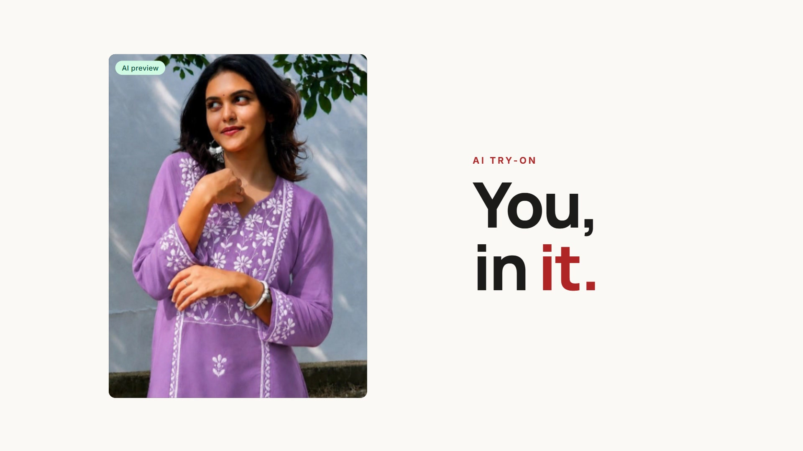

# Tryvelle — clothing store with AI photo try-on (demo, no payments)

[](docs/media/tryvelle-demo.mp4)

▶ [Watch the 21-second demo](docs/media/tryvelle-demo.mp4)

React + Vite storefront (`frontend/`) with on-device camera preview, FastAPI +
PostgreSQL API (`backend/`). First release is a **visual style preview + demo
ordering**: no fit measurement, no cloth simulation, no payment collection.

## Quick start (Windows PowerShell)

Backend:

```
python -m venv .venv
.\.venv\Scripts\pip install -r backend\requirements.txt
copy backend\.env.example backend\.env
cd backend
..\.venv\Scripts\alembic upgrade head
..\.venv\Scripts\python scripts\seed.py
..\.venv\Scripts\python -m uvicorn app.main:app --port 8000
```

Frontend (new shell, repo root):

```
cd frontend
npm install
npm run dev        # http://localhost:5173 — open /prototype/try-on for the camera
```

Camera needs HTTPS or `localhost`. Dev admin (explicit, env-only password):

```
$env:SETUP_ADMIN_EMAIL="you@example.com"
$env:SETUP_ADMIN_PASSWORD="..."
..\.venv\Scripts\python backend\scripts\create_admin.py
```

## Tests

```
cd backend && ..\..\.venv\Scripts\python -m pytest -q   # 27 API tests
cd frontend && npm test && npm run build                # 16 tests + build
```

## Backup / restore

- SQLite dev: copy `backend/dev.db` (stop the server first).
- PostgreSQL: `pg_dump -Fc tryon > tryon.dump` / `pg_restore -d tryon tryon.dump`.
- Apply `alembic upgrade head` before enabling dependent routes after a restore.
- Purge expired sessions/tokens: `python backend/scripts/purge_expired.py`.

## Docs

- `backend/README.md` — API setup; `backend/docs/API.md` — endpoint table.
- `LICENSES.md` — recorded package/model/asset licenses.
- `docs/RELEASE_CHECKLIST.md` — deployment gate; `docs/DEVICE_MATRIX.md` — camera test log.
- `docs/milestones/` — per-milestone notes. `ml/` — the try-on model (see `ml/README.md`).
- Local-only (never pushed): `documents/` spec pack, `frontend.html` prototype.
